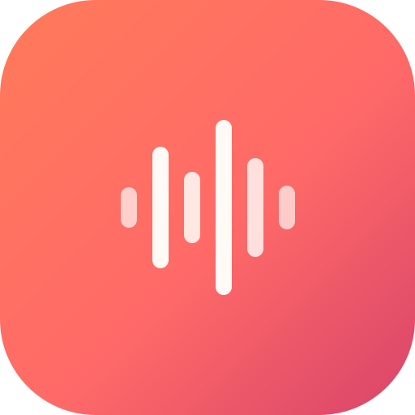

<div align="center">



# 🎵 MPAria

### *Your music. Your machine. No cloud. No ads. No account.*

**The private, offline-first music player that puts you back in control of your entire collection.**

Import your own files, organize them beautifully, and listen anywhere — even with zero internet.

[](releases/MPAria.dmg)
[](releases/MPAria.zip)
[](https://github.com/avikasmin5773-debug/MPAria)

[](#)
[](#)
[](#)

</div>

---

## ✨ Why MPAria?

| 🚫 What it doesn't do | ✅ What it does |
|---|---|
| No account, no signup | Import your own music in seconds |
| No cloud, no tracking | Stores everything locally on your Mac |
| No ads, no subscriptions | Works 100% offline |
| No copyrighted bundles | Auto-names, auto-thumbnails, auto-covers |

---

## 🎯 Features

<table>
<tr>
<td width="50%">

### 🏷️ Auto Namer
Names tracks from file names when tags are missing.

### 🖼️ Auto Thumbnail
Uses the first frame of a video as its thumbnail.

### 🎨 Drag & Drop Artwork
Accepts **any** image type to set cover art.

### 📝 Lyrics Editor
Per-track lyrics, stored locally.

### 🎛️ Equalizer
5-band EQ with presets.

</td>
<td width="50%">

### ⚡ Playback Speed
Cycle 0.5× → 2× on the fly.

### ⏩ Skip Buttons
±10s seek controls.

### 📀 Playlists
Create, import & export (JSON).

### 🔁 Duplicate Scanner
Find and remove duplicate tracks.

### ↩️ Undo Delete
Press `U` to restore a removed song.

</td>
</tr>
</table>

### 🌗 Themes · 📱 Mini Player · 🔒 100% Private

---

## 📸 Screenshots

<div align="center">

| Home | Songs |
|:---:|:---:|
|  |  |

| Albums | Artists |
|:---:|:---:|
|  |  |

| Settings |
|:---:|
|  |

</div>

---

## 🚀 Quick Start

### macOS (native app)

1. Download [`MPAria.dmg`](releases/MPAria.dmg) or [`MPAria.zip`](releases/MPAria.zip)
2. Open `MPAria.app`
3. Click **Try starter tracks** for instant royalty-free music

### Windows 10/11 · Linux · macOS (Apple Silicon)

```bash
git clone https://github.com/avikasmin5773-debug/MPAria.git
cd MPAria
./run.sh          # macOS / Linux
run.bat           # Windows
# open http://127.0.0.1:8000/index.html
```

### Build the native macOS shell

```bash
bash Contents/Resources/build-app.sh
```

Requires Xcode Command Line Tools (`swiftc`).

---

## 📁 Source structure

```
MPAria/
├── index.html
├── css/app.css
├── js/
│   ├── app.js
│   ├── db.js
│   ├── tags.js
│   └── audio-lab.js
├── sw.js
├── manifest.webmanifest
├── assets/
└── releases/
```

---

## ⚖️ Copyright & Privacy

> **MPAria does NOT bundle or download copyrighted music.**
> Import only files you own or have the rights to use.

- 🔒 All audio stays in your browser's private IndexedDB
- 🌐 Nothing is ever uploaded anywhere
- ✅ Works 100% offline after first load

---

## 🍺 Homebrew (macOS)

```bash
brew tap avikasmin5773-debug/homebrew-mparia
brew install --cask mparia
```

---

## 🤝 Contributing

Pull requests welcome. Keep the offline-first, privacy-first philosophy.

---

<div align="center">

**Made with ❤️ for your personal collection.**

⭐ Star this repo if you like it!

</div>
