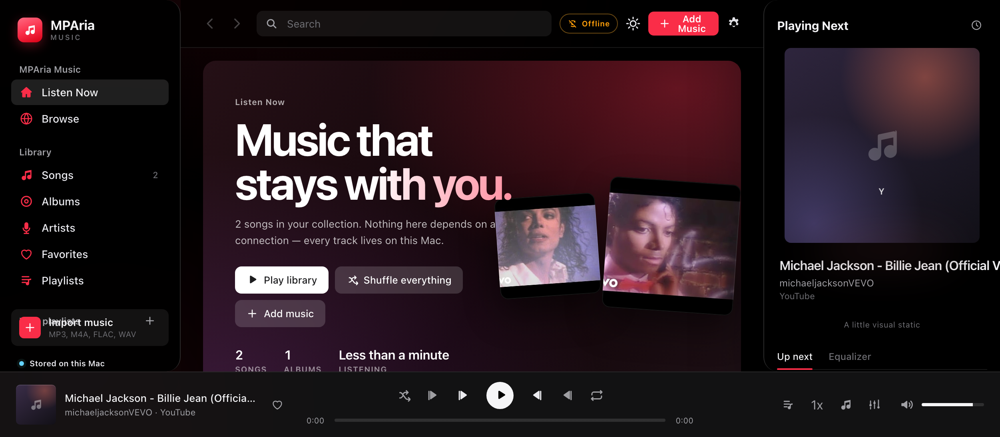
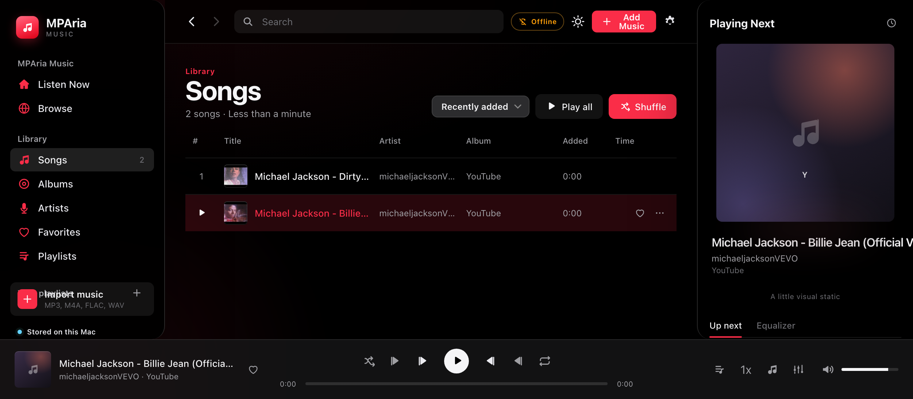
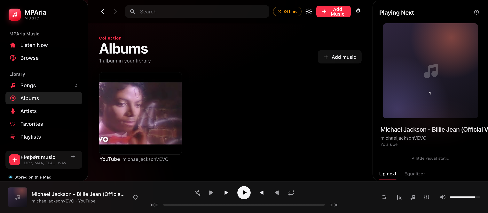
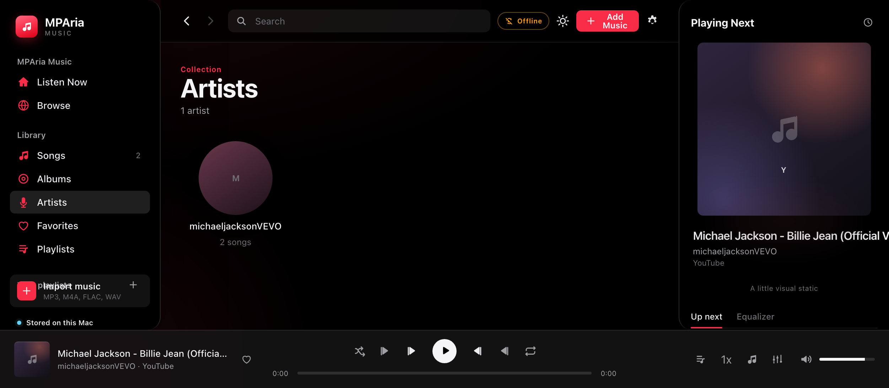
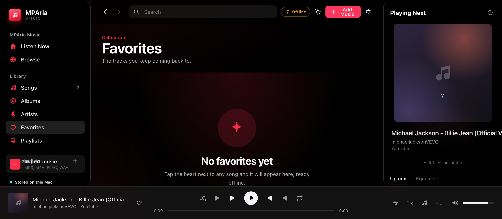

# MPAria — Offline Music Player

MPAria is a private, offline-first desktop music player for the music you own. It runs as a native macOS app (WKWebView + local server) and stores your library in the browser's IndexedDB on your Mac. Nothing is uploaded anywhere.

## Features

- Import MP3, M4A, FLAC, WAV, OGG and more (audio + video)
- Auto Namer: names tracks from file names when tags are missing
- Auto Thumbnail: uses the first frame of a video as its thumbnail
- Drag & drop images to set artwork (any image type accepted)
- Albums, artists, favorites, playlists
- Playlist import/export (JSON)
- Lyrics editor per track
- Equalizer with presets
- Playback speed control and ±10s skip
- Mini player mode
- Duplicate scanner and undo delete (press U)
- Dark/light themes
- Storage usage tracking

## Screenshots







## Setup

### Run the app (macOS)

1. Open `MPAria.app` (or run `Contents/MacOS/launcher`).
2. Requires Python 3 (used to serve the local library).

### Build from source

```bash
bash Contents/Resources/build-app.sh
```

Requires Xcode Command Line Tools (`swiftc`).

### Run the web UI standalone

Serve this folder over `http://127.0.0.1`:

```bash
python3 -m http.server 8000
```

Then open `http://127.0.0.1:8000/index.html`.

## Source structure

- `index.html` — app shell
- `css/app.css` — styles
- `js/app.js` — application logic
- `js/db.js` — IndexedDB storage
- `js/tags.js` — audio metadata reader
- `js/audio-lab.js` — starter track generator
- `sw.js` — service worker
- `manifest.webmanifest` — PWA manifest

## Copyright

MPAria does not bundle or download copyrighted music. Import only files you own or have rights to use.
